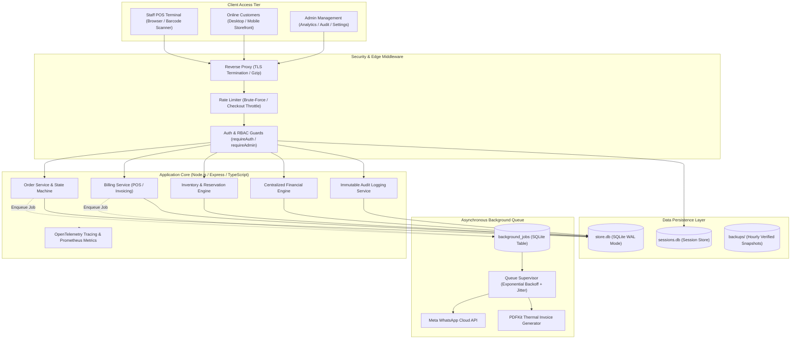

# Sri Tirumala Dry Fruits — Enterprise POS & E-Commerce Platform 🥜


An enterprise-grade, hybrid retail application engineered for **Sri Tirumala Dry Fruits & Millets** (Tekkali, Andhra Pradesh). It harmonizes a **zero-latency physical Point-of-Sale (POS) counter terminal** with a **modern digital e-commerce storefront**, automated WhatsApp notifications, centralized financial analytics, and a cryptographically chained immutable audit log.

---

## 📑 Table of Contents

1. [Business Problem & Solution](#1-business-problem--solution)
2. [System Architecture](#2-system-architecture)
3. [Major Feature Subsystems](#3-major-feature-subsystems)
4. [Technology Choices & Trade-offs](#4-technology-choices--trade-offs)
5. [Local Development Setup](#5-local-development-setup)
6. [Production Deployment Guide](#6-production-deployment-guide)
7. [Automated Testing & QA](#7-automated-testing--qa)
8. [Security & Compliance Posture](#8-security--compliance-posture)
9. [WhatsApp Automation Subsystem](#9-whatsapp-automation-subsystem)
10. [Demo Workflows & Terminal Previews](#10-demo-workflows--terminal-previews)
11. [Strategic Roadmap & Future Scope](#11-strategic-roadmap--future-scope)
12. [Engineering Documentation Index](#12-engineering-documentation-index)

---

## 1. Business Problem & Solution

### The Business Challenge
Traditional small-to-medium retail dry fruit and spice merchants face severe operational friction:
* **Siloed Systems**: In-store POS registers and online storefronts run on disconnected tools, causing inventory discrepancies, stockouts, and accidental overselling.
* **Counter Latency**: Cloud-based POS platforms suffer from internet latency, slowing checkout during peak physical store rush hours.
* **Unreliable Messaging**: Synchronous WhatsApp notifications block cashier checkout or web order creation when Meta's APIs experience latency or outages.
* **Financial Opacity**: Formula fragmentation across spreadsheets and ad-hoc views leads to inaccurate profit calculations, untracked waste, and reconciliatory disputes.
* **Auditability Gaps**: Internal fraud, unauthorized price adjustments, and untracked discounts erode margins without an immutable audit trail.

### The Architectural Solution
* **Local-First, Zero-Latency POS**: Powered by SQLite in Write-Ahead Logging (WAL) mode, barcode scans and thermal receipts execute in sub-milliseconds without cloud dependencies.
* **Unified Inventory & Reservation State Machine**: Physical sales and online carts share an atomic stock ledger backed by strict database constraints (`CHECK (total_qty - sold_qty >= 0)`).
* **Fault-Tolerant Background Messaging**: An in-process durable background queue isolates WhatsApp messaging so order creation **never blocks** if external APIs fail.
* **Centralized Zero-Duplication Financial Engine**: Pure, deterministic mathematical formulas calculate Gross/Net Revenue, COGS, Profit Margins, and AOV from a single source of truth.
* **Cryptographically Chained Immutable Audit Log**: SQLite engine-level triggers prohibit `UPDATE` and `DELETE` queries on audit history, with SHA-256 parent hash chaining for tamper evidence.

---

## 2. System Architecture

The application is structured as a modular TypeScript monolith following Controller-Service-Repository separation with an asynchronous background queue:



---

## 3. Major Feature Subsystems

### 🛒 Modern Omnichannel Storefront
* **Catalog Exploration**: Responsive grid displaying dry fruits, wholesome millets, nutritious seeds, and spices with search and category filtering.
* **Customer Authentication & Account**: Secure signup, login, password hashing, and address book management.
* **Shopping Cart & Wishlist**: Slide-out cart drawer with dynamic subtotal recalculation and inventory availability validation.
* **Checkout & Payment**: Supports Cash on Delivery (COD) and instant UPI QR code payment.
* **Order Tracking Portal**: Real-time status tracker displaying order progress (`NEW` $\to$ `CONFIRMED` $\to$ `PACKING` $\to$ `READY` $\to$ `DISPATCHED` $\to$ `COMPLETED`).
* **Technical SEO Engine**: Automated meta titles, unique descriptions, Open Graph cards, canonical URLs, and JSON-LD structured data (`Product`, `LocalBusiness`).

### 💳 Lightning-Fast POS Billing Terminal
* **Rapid Barcode Scanning**: Immediate keyboard buffer capture and F-key shortcuts (`F1` Help, `F2` Bill, `F3` Hold, `F4` Search).
* **Bill Suspend & Resume**: Suspend active bills to assist secondary customers without losing entered line items.
* **Shift Cash Register Reconciliation**: Enforces opening cash declaration, expected closing cash calculation, and actual drawer balance verification.
* **Thermal PDF Invoices**: Generates 80mm thermal receipts with GST breakdowns, business details, and barcodes.
* **Returns & Refunds**: Line-item return processing with automatic stock replenishment and profit deduction.
* **POS Conversion**: Seamless conversion of online pickup orders into in-store POS bills (`POS_CONVERT`).

### 📊 Production Analytics & Financial Dashboard
* **13 Core Business Metrics**: Today's, Weekly, Monthly, and All-Time Revenue; POS vs. Online revenue split; Order count; Average Order Value (AOV); Repeat Customer Rate; Cancellation Rate; Depleted Stockouts; and WhatsApp Conversion Rate.
* **Multi-Dimensional Slice-and-Dice**: Filter by date presets (`today`, `7d`, `30d`, `month`, `year`, `all`), custom ranges, categories, products, channels, and statuses.
* **Interactive Visualizations**: Chart.js revenue velocity trendlines and category revenue doughnut distributions.
* **Product Leaderboards**: Top 10 Best Sellers (by volume/revenue) and Top 10 Most Profitable Products (by net profit/margin %).
* **Export Controls**: Client-side CSV export and print-optimized executive reporting.

### 🛡️ Enterprise Immutable Audit Log System
* **Engine-Level Immutability**: SQLite triggers reject any direct `UPDATE` or `DELETE` on `audit_logs`.
* **Cryptographic Hash Chaining**: Every record is linked via SHA-256 parent hash pointers (`prev_hash` $\to$ `hash`) for tamper-evident ledger verification.
* **12 Tracked Events**: `LOGIN`, `FAILED_LOGIN`, `PRODUCT_CREATE`, `PRODUCT_UPDATE`, `PRICE_MODIFY`, `INVENTORY_ADJUST`, `ORDER_CONFIRM`, `ORDER_CANCEL`, `RETURN`, `REFUND`, `ROLE_CHANGE`, `POS_CONVERT`.
* **Admin Audit Explorer**: Search, filter, payload inspector modal, and integrity verification API (`GET /api/v1/audit-logs/verify`).

---

## 4. Technology Choices & Trade-offs

| Component | Selected Technology | Architectural Justification | Alternatives Considered & Rejected |
| :--- | :--- | :--- | :--- |
| **Language** | **TypeScript 5.x** | Strong static typing across domain models, eliminating runtime type errors in financial calculations. | Plain JavaScript (lack of type safety for financial logic). |
| **Backend** | **Node.js 20 LTS + Express.js** | Lightweight, event-driven I/O with mature middleware ecosystem and zero cold-start latency. | Python Flask / Django (legacy code was replaced for unified async I/O). |
| **Data Layer** | **SQLite (`better-sqlite3`) + WAL** | In-process execution eliminates network roundtrips (< 1ms queries). WAL mode enables high concurrency. Single-file portability makes backups instantaneous. | PostgreSQL / MySQL (adds network latency, container bloat, and connection pool overhead). |
| **Rendering** | **Server-Side Rendered (EJS)** | Instant initial page loads, optimal SEO indexing, and zero frontend build pipeline complexity on older POS terminals. | Single-Page Apps (React/Vue adds heavy client bundles and complex hydration). |
| **Queue** | **SQLite Table Queue** | In-process background processing decoupled from HTTP requests without requiring external infrastructure. | Redis + BullMQ (adds external daemon dependency, memory overhead, and network hop). |
| **Tracing** | **OpenTelemetry Spans + Prometheus** | Vendor-neutral W3C distributed context propagation and standard metrics exposition. | Proprietary APMs (Datadog/NewRelic introduces vendor lock-in). |

---

## 5. Local Development Setup

### Prerequisites
* **Node.js**: v20 LTS or higher (`node -v`)
* **npm**: v9 or higher (`npm -v`)
* **Git**

### Installation Steps

1. **Clone the repository:**
   ```bash
   git clone https://github.com/gunasekhar-7/SriTrimulaDryFruits.git
   cd SriTrimulaDryFruits
   ```

2. **Install project dependencies:**
   ```bash
   npm install
   ```

3. **Configure environment variables:**
   ```bash
   cp .env.example .env
   ```
   *For local development, default values in `.env.example` will work out of the box.*

4. **Verify TypeScript compilation:**
   ```bash
   npx tsc --noEmit
   ```

5. **Start the development server:**
   ```bash
   npm run dev
   ```

6. **Access the application:**
   * Public Storefront: [http://localhost:3000](http://localhost:3000)
   * Staff POS Login: [http://localhost:3000/login](http://localhost:3000/login)
   * Default Admin Credentials: `admin` / `admin123`
   * Default Staff Credentials: `staff` / `staff123`

---

## 6. Production Deployment Guide

The application is deployed using a hardened, multi-stage Docker container managed by Docker Compose.

```bash
# 1. Export production release tag
export IMAGE_TAG="v2.4.0"

# 2. Configure production secrets
cp .env.production.example .env.production
# Generate cryptographically secure keys:
node scripts/generate_secrets.js

# 3. Launch hardened production stack
docker compose -f docker-compose.prod.yml up -d --build

# 4. Verify container health status
docker compose -f docker-compose.prod.yml ps
curl -f http://localhost:3000/health
```

*For complete deployment topologies, resource quotas, and zero-downtime rolling restart runbooks, refer to [`docs/DEPLOYMENT.md`](file:///c:/Projects/sri-tirmula-dryfruits/docs/DEPLOYMENT.md).*

### Production Backups & Disaster Recovery Operations

The production image packages hardened backup and restore CLI entry points:

```bash
# 1. Execute on-demand verified atomic SQLite backup
docker compose exec pos-app npm run backup
# Or directly: node dist/scripts/run_backup.js

# 2. Trigger offsite cloud backup synchronization
docker compose exec pos-app npm run backup:offsite
# Or directly: node dist/scripts/backup_offsite.js

# 3. Restore database from verified backup
docker compose exec pos-app node dist/scripts/restore_backup.js /app/data/backups/backup_<timestamp>.db /app/data/store.db

# 4. Run automated production backup smoke test
npm run test:backup
```

*For complete disaster recovery playbooks, forensic snapshot recovery, and RPO/RTO validation, refer to [`docs/DISASTER_RECOVERY.md`](file:///c:/Projects/sri-tirmula-dryfruits/docs/DISASTER_RECOVERY.md).*

---

## 7. Automated Testing & QA

The repository maintains an automated test pyramid with **248 passing tests across 29 test files**:

```bash
# Run the complete test suite
npm test

# Run tests with single-process isolation (prevents SQLite file locks)
npx vitest run --fileParallelism=false

# Run a specific unit test suite
npx vitest run tests/unit/financial.unit.test.ts

# Run audit system integration tests
npx vitest run tests/integration/audit.test.ts
```

### Test Suite Distribution:
* **Unit Tests (81 tests)**: Financial formulas, pricing/discounts/tax/delivery, inventory reservations, order state machine, audit log triggers, and SEO metadata.
* **Integration Tests (78 tests)**: Billing & POS, variants, inventory movements, WhatsApp integration, analytics API, and audit log RBAC.
* **E2E Tests (45 tests)**: Customer registration & checkout journey, cashier shift billing, and online order fulfillment.
* **Security Tests (44 tests)**: CSRF validation, rate limiting, BOLA/IDOR protection, and webhook signature verification.

*For detailed test taxonomy and assertion matrices, see [`docs/TESTING.md`](file:///c:/Projects/sri-tirmula-dryfruits/docs/TESTING.md).*

---

## 8. Security & Compliance Posture

* **Database Engine Immutability**: SQLite triggers reject any direct `UPDATE` or `DELETE` on `audit_logs`.
* **Zero SQL Injection**: Every database query executes through parameterized prepared statements (`better-sqlite3`).
* **CSRF Protection**: Double-submit cookie verification with cryptographically random tokens rotated per session.
* **Rate Limiting**: Brute-force login defense (max 10 attempts/15 min) and checkout flood throttling (max 15/15 min).
* **BOLA / IDOR Defense**: Strict tenancy checks bind orders, carts, and addresses to `req.session.customer_id`.
* **Container Hardening**: Unprivileged non-root execution (`node:node` / UID 1000), `cap_drop: [ALL]`, and `tmpfs` mounts.

*For full threat modeling and RBAC specifications, see [`docs/SECURITY.md`](file:///c:/Projects/sri-tirmula-dryfruits/docs/SECURITY.md).*

---

## 9. WhatsApp Automation Subsystem

The application connects to the **Meta WhatsApp Cloud API** via an asynchronous durable queue:

* **Non-Blocking Order Placement**: Order creation and POS billing never stall if Meta servers experience latency or downtime.
* **Automated Status Templates**: Notifications trigger on state transitions (`NEW`, `CONFIRMED`, `PACKING`, `READY`, `DISPATCHED`, `COMPLETED`, `CANCELLED`).
* **Idempotency Guarantee**: Key pattern `whatsapp_order_{orderId}_{status}` prevents duplicate customer alerts.
* **HMAC SHA-256 Webhooks**: Inbound webhooks are validated using timing-safe signature comparison.

*For the complete sequence diagram and template catalog, see [`docs/WHATSAPP_INTEGRATION.md`](file:///c:/Projects/sri-tirmula-dryfruits/docs/WHATSAPP_INTEGRATION.md).*

---

## 10. Demo Workflows & Terminal Previews

### Cashier POS Billing Workflow
```text
┌────────────────────────────────────────────────────────────────────────┐
│  SRI TIRUMALA DRYFRUITS — POS TERMINAL DESK       [Shift: Open (Cashier)]│
├────────────────────────────────────────────────────────────────────────┤
│  [ F1: Help ]  [ F2: Generate Bill ]  [ F3: Hold ]  [ F4: Search Bills ] │
├────────────────────────────────────────────────────────────────────────┤
│  Scan Barcode: [ 8901234567890                        ] [ Add to Cart ]│
│                                                                        │
│  Item Name                    Qty     Unit Price     Tax      Total    │
│  ───────────────────────────────────────────────────────────────────  │
│  1. W240 Jumbo Cashews        2.0 kg  ₹850.00        5%       ₹1,700.00│
│  2. California Almonds (Reg)  1.0 kg  ₹720.00        5%       ₹  720.00│
│  ───────────────────────────────────────────────────────────────────  │
│  Subtotal: ₹2,420.00   |   Discount: ₹120.00   |   Payable: ₹2,300.00  │
│  Payment: [✓] Cash   [ ] UPI   [ ] Card        |   [ Print 80mm Bill ] │
└────────────────────────────────────────────────────────────────────────┘
```

### Executive Analytics Dashboard
```text
┌────────────────────────────────────────────────────────────────────────┐
│  EXECUTIVE ANALYTICS DASHBOARD                  [Preset: Last 30 Days] │
├────────────────────────────────────────────────────────────────────────┤
│  [ Today: ₹4,850 ]  [ 7-Day: ₹34,200 ]  [ 30-Day: ₹142,000 ]  [All: ₹840K]│
├────────────────────────────────────────────────────────────────────────┤
│  Total Revenue    Net Gross Profit   Margin %    AOV       Repeat Rate │
│  ₹142,000.00      ₹48,280.00         34.00%      ₹500.00   38.20%      │
├────────────────────────────────────────────────────────────────────────┤
│  Channel Breakdown:  POS: ₹98,000 (69.0%)   |   Online: ₹44,000 (31.0%) │
│  Order Churn:        Cancellations: 6 (2.11%) |  WhatsApp Conv: 41.5%   │
│  Inventory Alert:    Stock-outs: 1 variant   |   Low Stock: 4 variants │
└────────────────────────────────────────────────────────────────────────┘
```

---

## 11. Strategic Roadmap & Future Scope

The application has matured from an initial script prototype into a production-hardened omnichannel retail platform. To steer future product development and commercial scaling, initiatives are organized into four strategic horizons:

* **Phase 1: Near-Term High-ROI Upgrades (Months 1–3)**
  * **Automated Payments & Counter Dynamic BharatQR**: Automated payment gateway webhooks (Razorpay / Cashfree) for online orders and dynamically generated UPI QR codes on the cashier POS terminal for touchless counter settlements.
  * **Statutory GST B2B Invoicing**: Full HSN code catalog (`0801`, `0802`, `1008`), CGST/SGST/IGST tax splits, B2B customer GSTIN handling, and GSTR-1 export summaries.
  * **Offline-First POS Terminal (PWA)**: Service Worker and IndexedDB fallback allowing cashiers to continue barcode scanning and printing receipts during network or broadband outages.

* **Phase 2: Growth & Supply Chain Operations (Months 3–6)**
  * **Batch, Lot & Expiry Tracking (FIFO)**: Shelf-life monitoring for dry fruits, seeds, and spices with automated expiry warning dashboards and First-In, First-Out inventory exhaustion.
  * **Supplier PO & Inward Goods (GRN)**: Structured procurement workflows with freight calculation and Moving Average Cost (MAC) recalculations.
  * **Loyalty Rewards & WhatsApp Drips**: Phone-linked reward points, tiered customer VIP clubs, automated abandoned cart recovery, and post-delivery review requests.

* **Phase 3: Enterprise Scalability & Cloud Architecture (Months 6–12)**
  * **Database Scaling Path**: Evaluation of LiteFS/Litestream for streaming SQLite replication, or direct migration to managed PostgreSQL for high-concurrency cloud scaling.
  * **Multi-Branch Chain Management**: Centralized multi-store inventory distribution, transit tracking, and per-terminal cash float reconciliation.
  * **Cloud Object Storage & CDN Asset Pipeline**: Offloading product photography to Cloudflare R2 / AWS S3 with on-the-fly WebP/AVIF compression.

* **Phase 4: AI & Predictive Commerce (Months 12+)**
  * **WhatsApp Conversational AI Bot**: Natural-language multi-lingual (English, Telugu, Hindi) ordering assistant via Meta WhatsApp Business Cloud API.
  * **Predictive Demand Forecasting**: Machine-learning-driven seasonal stock procurement planning for major Indian festivals (Diwali, Ramzan, Sankranti).

*For the complete detailed roadmap, architecture blueprints, and prioritization matrix, see [`docs/FUTURE_SCOPE.md`](file:///c:/Projects/sri-tirmula-dryfruits/docs/FUTURE_SCOPE.md).*

---

## 12. Engineering Documentation Index

Detailed architectural and operational documentation is maintained in the [`docs/`](file:///c:/Projects/sri-tirmula-dryfruits/docs/) directory:

| Document | Description |
| :--- | :--- |
| [`docs/FUTURE_SCOPE.md`](file:///c:/Projects/sri-tirmula-dryfruits/docs/FUTURE_SCOPE.md) | Comprehensive project retrospective, current capabilities, and 4-phase strategic future roadmap. |
| [`docs/ARCHITECTURE.md`](file:///c:/Projects/sri-tirmula-dryfruits/docs/ARCHITECTURE.md) | High-level system architecture, POS sequence, online checkout sequence, and order state machine. |
| [`docs/DATABASE.md`](file:///c:/Projects/sri-tirmula-dryfruits/docs/DATABASE.md) | Complete Mermaid ERD, table specifications, constraints, triggers, and WAL pragma configuration. |
| [`docs/API.md`](file:///c:/Projects/sri-tirmula-dryfruits/docs/API.md) | Full REST API (v1) specification, request/response schemas, error codes, and RBAC requirements. |
| [`docs/SECURITY.md`](file:///c:/Projects/sri-tirmula-dryfruits/docs/SECURITY.md) | Threat model, RBAC access matrix, BOLA/IDOR defenses, CSRF protection, and audit immutability. |
| [`docs/DEPLOYMENT.md`](file:///c:/Projects/sri-tirmula-dryfruits/docs/DEPLOYMENT.md) | Docker architecture diagram, multi-stage Dockerfile, environment matrix, and rollback runbooks. |
| [`docs/TESTING.md`](file:///c:/Projects/sri-tirmula-dryfruits/docs/TESTING.md) | Quality engineering strategy, Vitest taxonomy, 248 test suite breakdown, and CI/CD pipelines. |
| [`docs/WHATSAPP_INTEGRATION.md`](file:///c:/Projects/sri-tirmula-dryfruits/docs/WHATSAPP_INTEGRATION.md) | Meta Cloud API architecture, notification sequence, template catalog, and webhook verification. |
| [`docs/DISASTER_RECOVERY.md`](file:///c:/Projects/sri-tirmula-dryfruits/docs/DISASTER_RECOVERY.md) | RPO/RTO targets, 4-tier automated backup verification, sandbox restore testing, and disaster playbooks. |
| [`docs/RUNBOOK.md`](file:///c:/Projects/sri-tirmula-dryfruits/docs/RUNBOOK.md) | Operational incident playbooks for SQLite locks, queue backlogs, memory spikes, and disk exhaustion. |
| [`docs/CHANGELOG.md`](file:///c:/Projects/sri-tirmula-dryfruits/docs/CHANGELOG.md) | Semantic Versioning history tracking milestones from v1.0.0 through v2.4.0. |
| [`docs/ANALYTICS.md`](file:///c:/Projects/sri-tirmula-dryfruits/docs/ANALYTICS.md) | Centralized financial business logic formulas, metric definitions, and dashboard features. |
| [`docs/AUDIT_LOG_SYSTEM.md`](file:///c:/Projects/sri-tirmula-dryfruits/docs/AUDIT_LOG_SYSTEM.md) | Cryptographic hash chaining specification, SQLite triggers, and audit event catalog. |

---

## 📄 License & Ownership

Proprietary software built exclusively for **Sri Tirumala Dry Fruits & Millets**, Tekkali, Srikakulam District, Andhra Pradesh, India. All rights reserved.
