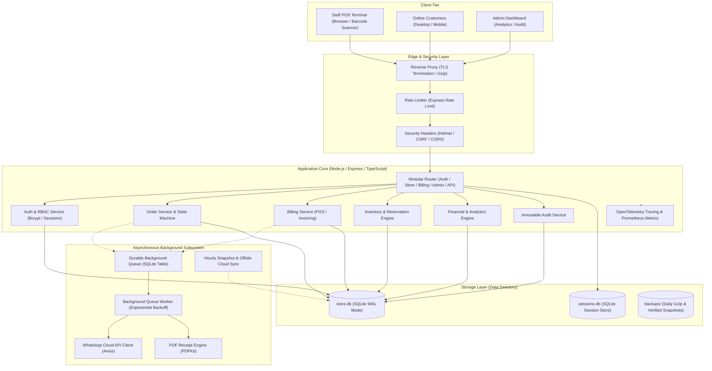
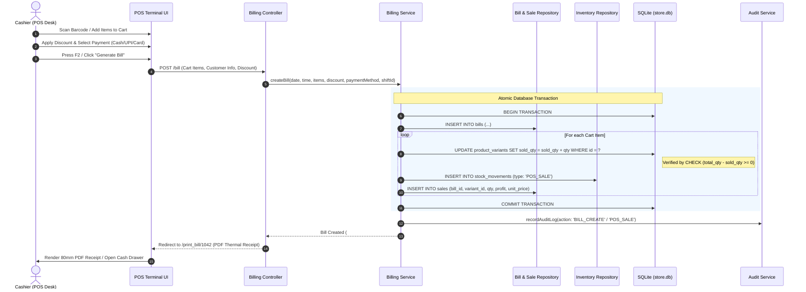
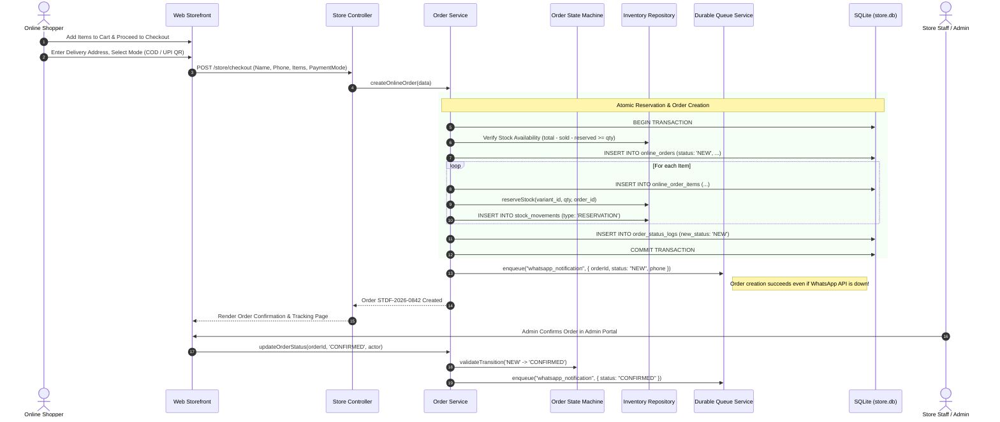
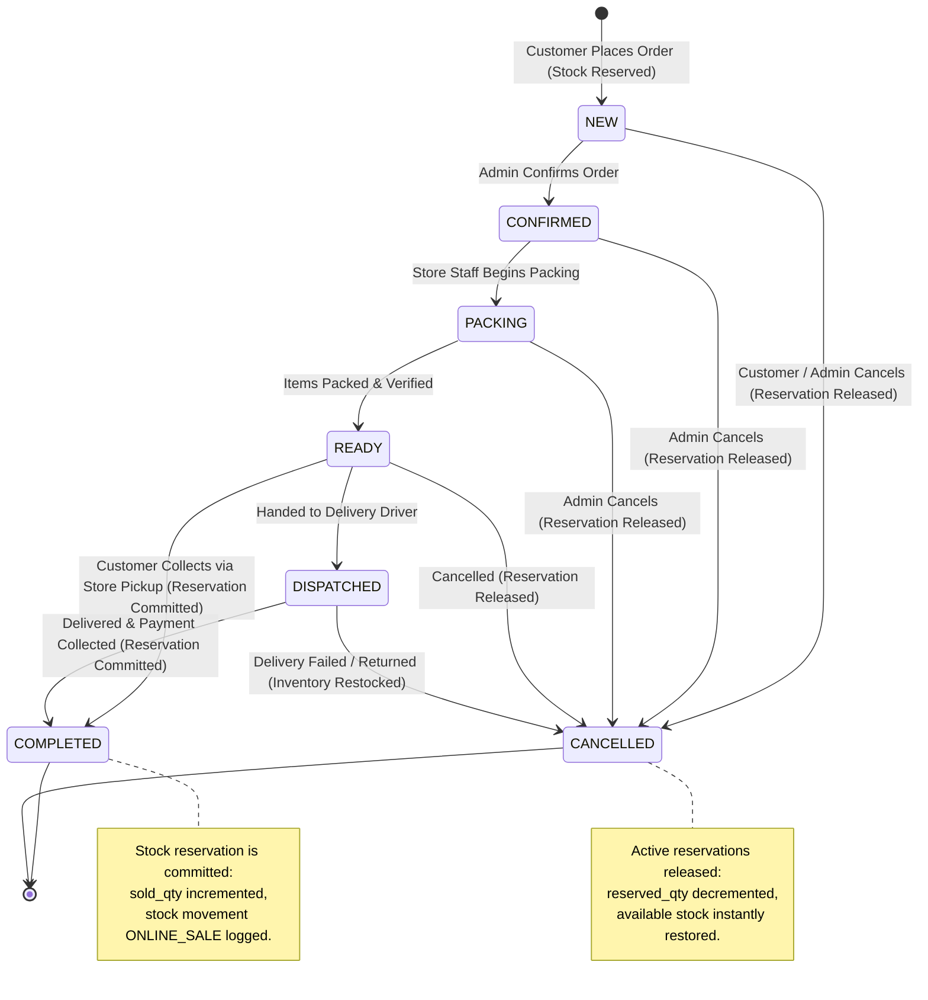

# System Architecture & Technical Design

## 1. Executive Summary & Architectural Principles

Sri Tirumala Dry Fruits is a production-grade, hybrid retail application engineered to power both a high-throughput physical Point-of-Sale (POS) counter and an omnichannel online e-commerce storefront.

### Core Architectural Pillars

1. **Monolithic Efficiency with Asynchronous Decoupling**:
   - The application is architected as a modular TypeScript/Node.js monolith utilizing Express.js.
   - Synchronous HTTP request-response cycles are strictly isolated from non-critical or external I/O (such as WhatsApp notifications, invoice generation, cloud backup synchronization, and reporting aggregations) via an in-process, SQLite-backed durable background queue.
2. **Local-First, Zero-Latency Data Layer (SQLite with WAL)**:
   - For single-location retail operations, SQLite operating in Write-Ahead Logging (WAL) mode eliminates network socket hops, delivering sub-millisecond read/write performance essential for rapid barcode scanning and physical billing desk operations.
   - Strict database constraints (`CHECK (total_qty - sold_qty >= 0)`) provide immediate concurrency protection against stock over-allocation.
3. **Omnichannel Harmonization**:
   - Online storefront orders and physical POS bills share a unified inventory catalog, reservation ledger, and customer repository.
   - The system supports seamless **POS Conversion**: online click-and-collect orders can be pushed directly into the physical billing desk register with automated reservation release.
4. **End-to-End Auditability & Tracing**:
   - OpenTelemetry-compatible distributed tracing tracks workflows across HTTP gateways, service layers, database operations, background queues, and external webhooks using standard W3C `traceparent` headers.
   - Every administrative, financial, and inventory alteration is captured in an append-only, cryptographically hash-chained immutable audit log.

---

## 2. High-Level System Architecture

The following diagram illustrates the overarching system architecture, separating client tiers, application boundaries, background subsystems, and storage engines:



---

## 3. POS Checkout Sequence

Physical in-store transactions require sub-second responsiveness. The checkout sequence executes atomically within a single SQLite database transaction to guarantee stock consistency:



---

## 4. Online Checkout Sequence

Online checkout integrates stock reservation guarantees, payment mode selection, and asynchronous WhatsApp notification queuing:



---

## 5. Order Lifecycle State Machine

The online order lifecycle is strictly enforced by a finite state machine (`src/services/order-state-machine.ts`). Invalid status transitions are rejected at the business logic layer:



### Transition Validation Rules

| Current Status | Allowed Target Statuses | Inventory Action |
| :--- | :--- | :--- |
| `NEW` | `CONFIRMED`, `CANCELLED` | On Cancel: Release reservation (`reserved_qty -= qty`). |
| `CONFIRMED` | `PACKING`, `CANCELLED` | On Cancel: Release reservation (`reserved_qty -= qty`). |
| `PACKING` | `READY`, `CANCELLED` | On Cancel: Release reservation (`reserved_qty -= qty`). |
| `READY` | `DISPATCHED`, `COMPLETED`, `CANCELLED` | On Complete: Commit reservation (`sold_qty += qty`). |
| `DISPATCHED` | `COMPLETED`, `CANCELLED` | On Complete: Commit reservation (`sold_qty += qty`). |
| `COMPLETED` | `CANCELLED` (Admin Return Only) | On Cancel: Restock sold item (`sold_qty -= qty`, `RETURN` logged). |
| `CANCELLED` | Terminal State | None (No transitions permitted). |

---

## 6. Durable Background Queue Architecture

To maintain high throughput and reliability, non-critical background jobs never block synchronous HTTP request threads.

### Queue Characteristics
* **Persistence**: Stored durably in the `background_jobs` SQLite table. Unprocessed jobs survive application restarts and container crashes.
* **Polling & Locking**: A lightweight polling supervisor (`setInterval(..., 3000)`) queries for pending jobs with `status = 'PENDING'` and `run_at <= CURRENT_TIMESTAMP`, using database row leases (`locked_until`) to prevent race conditions.
* **Exponential Backoff with Jitter**: If an external API (such as Meta's WhatsApp endpoint) fails, the job schedule increases exponentially ($2^{\text{attempts}} \times \text{baseDelay}$) with randomized jitter to prevent thundering herd spikes.
* **Dead-Letter State**: Jobs failing more than `max_retries` (default: 5) transition to `FAILED` with full error stack traces preserved in `last_error` for manual inspection and re-triggering.
* **Idempotency**: Strict uniqueness enforced via `idempotency_key` (e.g. `whatsapp_order_842_CONFIRMED`) preventing duplicate messaging.

---

## 7. Distributed Tracing & Telemetry Architecture

Every user request is instrumented with OpenTelemetry-compatible tracing:

```text
HTTP Request (Traceparent Header or Generated W3C ID)
  │
  ├──► Route Handler Span
  │      │
  │      ├──► Service Layer Span (order.service:createOnlineOrder)
  │      │      │
  │      │      ├──► Database Transaction Span (db:insertOrder, db:reserveStock)
  │      │      │
  │      │      └──► Queue Enqueue Span (queue:enqueue_whatsapp)
  │      │             │
  │      │             └──► [Asynchronous Job Processing]
  │      │                    │
  │      │                    ├──► WhatsApp API Call Span (whatsapp:sendTemplate)
  │      │                    │
  │      │                    └──► Webhook Ingestion Span (whatsapp:deliveryWebhook)
  │      │
  │      └──► HTTP Response Span (200 OK)
```

Engineers can trace the exact lifecycle of an order from initial web click through database persistence, background queue execution, WhatsApp delivery, and customer status confirmation.
