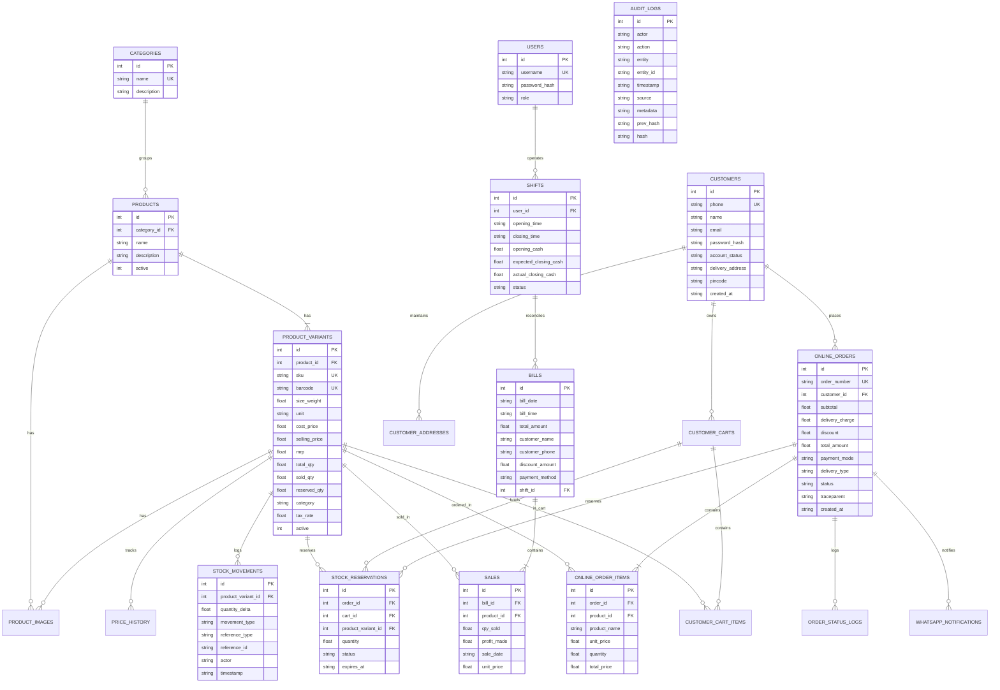

# Database Architecture & Entity Relationship Guide

## 1. Overview & Data Layer Strategy

Sri Tirumala Dry Fruits uses **SQLite (version 3.40+)** accessed via the native C++ driver `better-sqlite3`.

### Why SQLite with Write-Ahead Logging (WAL)?
1. **Zero Network Latency**: Running in-process eliminates network roundtrips, allowing POS transactions and inventory queries to execute in microseconds.
2. **High Concurrency**: In WAL mode (`journal_mode = WAL`), read transactions never block write transactions, and write transactions never block readers.
3. **Transactional Integrity (ACID)**: Full serializable transactions ensure multi-item orders, inventory decrements, and sales records commit or roll back atomically.
4. **Hardware Simplicity**: The entire application state resides in a single, portable database file (`data/store.db`), drastically reducing operational complexity and facilitating instantaneous automated backups.

---

## 2. Complete Entity Relationship Diagram (ERD)

The following Mermaid ER diagram illustrates the core entities, relationships, primary keys, foreign keys, and cardinalities:



---

## 3. Data Dictionary & Table Specifications

### 3.1 `product_variants` (Core Inventory)
Tracks sellable items, SKUs, barcodes, wholesale costs, retail pricing, and physical counts.

| Column | Type | Constraints | Description |
| :--- | :--- | :--- | :--- |
| `id` | INTEGER | PRIMARY KEY AUTOINCREMENT | Unique variant identifier. |
| `product_id` | INTEGER | NOT NULL, REFERENCES products(id) | Parent master product. |
| `sku` | TEXT | UNIQUE | Internal stock keeping unit (e.g. `ALM-W240-500G`). |
| `barcode` | TEXT | NOT NULL, UNIQUE | EAN/UPC scanned at checkout. |
| `cost_price` | REAL | NOT NULL DEFAULT 0 | Wholesale procurement cost. |
| `selling_price`| REAL | NOT NULL DEFAULT 0 | Retail price charged to customer. |
| `mrp` | REAL | NOT NULL DEFAULT 0 | Maximum Retail Price printed on label. |
| `total_qty` | REAL | NOT NULL DEFAULT 0 | Total acquired inventory stock. |
| `sold_qty` | REAL | NOT NULL DEFAULT 0 | Cumulative sold units. |
| `reserved_qty`| REAL | NOT NULL DEFAULT 0 | Units reserved in active online carts/orders. |
| `tax_rate` | REAL | NOT NULL DEFAULT 0 | Applicable GST percentage (e.g. 5, 12, 18). |
| `active` | INTEGER | DEFAULT 1 | Soft-delete flag (1 = active, 0 = archived). |

* **Integrity Constraint**: `CONSTRAINT check_inventory CHECK (total_qty - sold_qty >= 0)`.
  * *Enforcement*: Rejects any transaction that would result in overselling or negative inventory.

---

### 3.2 `bills` and `sales` (POS Ledger)
Records physical store invoices and individual line items with cashier shift associations.

* **`bills`**:
  * `id`: Auto-incrementing invoice number printed on customer receipts.
  * `total_amount`: Final payable sum after discounts.
  * `shift_id`: Foreign key link to cashier register shift for day-end reconciliation.
  * `payment_method`: One of `'Cash'`, `'UPI'`, or `'Card'`.
* **`sales`**:
  * Line-item table linking `bill_id` and `product_id`.
  * Stores `profit_made` calculated at the precise moment of sale: $(\text{unit\_price} - \text{cost\_price}) \times \text{qty} - \text{item\_discount}$.

---

### 3.3 `online_orders` and `online_order_items` (E-Commerce)
Manages digital storefront orders, fulfillment states, delivery addresses, and tracing contexts.

* **`online_orders`**:
  * `order_number`: Formatted external reference (e.g. `STDF-2026-0842`).
  * `status`: Finite state machine check constraint: `CHECK (status IN ('NEW', 'CONFIRMED', 'PACKING', 'READY', 'DISPATCHED', 'COMPLETED', 'CANCELLED'))`.
  * `payment_mode`: `CHECK (payment_mode IN ('COD', 'UPI_QR'))`.
  * `traceparent`: W3C distributed tracing context header string.

---

### 3.4 `audit_logs` (Cryptographically Chained Immutable Ledger)
Captures every critical administrative, catalog, financial, and authentication action.

| Column | Type | Constraints | Description |
| :--- | :--- | :--- | :--- |
| `id` | INTEGER | PRIMARY KEY AUTOINCREMENT | Sequential record index. |
| `actor` | TEXT | NOT NULL | User identity (e.g. `staff:1 (admin:admin)` or `customer:4`). |
| `action` | TEXT | NOT NULL | Event type (`LOGIN`, `PRICE_MODIFY`, `REFUND`, etc.). |
| `entity` | TEXT | NOT NULL | Domain entity (`USER`, `PRODUCT`, `ORDER`, `BILL`, etc.). |
| `entity_id` | TEXT | NULLABLE | Primary key or reference identifier of the entity. |
| `timestamp` | TEXT | NOT NULL DEFAULT (datetime('now')) | UTC timestamp. |
| `source` | TEXT | NOT NULL | Origin string (`IP:127.0.0.1 \| CH:POS \| UA:Mozilla...`). |
| `metadata` | TEXT | NULLABLE | JSON string with state diffs, reasons, and amounts. |
| `prev_hash` | TEXT | NULLABLE | SHA-256 hash of the preceding record (`'GENESIS'` for id=1). |
| `hash` | TEXT | NOT NULL | SHA-256 digest of $(prev\_hash \parallel actor \parallel action \parallel \dots)$. |

---

## 4. Hardened Immutability Triggers

To prevent tampering by malicious insiders or application vulnerabilities, SQLite triggers reject `UPDATE` and `DELETE` queries on the audit ledger:

```sql
CREATE TRIGGER IF NOT EXISTS prevent_audit_log_update
BEFORE UPDATE ON audit_logs
BEGIN
  SELECT RAISE(FAIL, 'Immutable audit log: UPDATE operations are strictly prohibited.');
END;

CREATE TRIGGER IF NOT EXISTS prevent_audit_log_delete
BEFORE DELETE ON audit_logs
BEGIN
  SELECT RAISE(FAIL, 'Immutable audit log: DELETE operations are strictly prohibited.');
END;
```

---

## 5. Performance Indexes & Pragmas

### SQLite Pragmas configured on startup (`src/database.ts`):
```sql
PRAGMA journal_mode = WAL;
PRAGMA foreign_keys = ON;
PRAGMA busy_timeout = 10000;
```

### Critical Indexes:
* **Inventory & Search**:
  * `idx_product_variants_barcode` on `product_variants(barcode)` (UNIQUE)
  * `idx_product_variants_sku` on `product_variants(sku)` (UNIQUE)
* **Reservations & Orders**:
  * `idx_stock_reservations_status` on `stock_reservations(status)`
  * `idx_stock_reservations_order` on `stock_reservations(order_id)`
  * `idx_online_orders_customer` on `online_orders(customer_id)`
* **Background Queue**:
  * `idx_background_jobs_polling` on `background_jobs(status, run_at)`
  * `idx_background_jobs_idempotency` on `background_jobs(idempotency_key)`
* **Audit & Backups**:
  * `idx_audit_logs_action` on `audit_logs(action)`
  * `idx_audit_logs_entity` on `audit_logs(entity, entity_id)`
  * `idx_audit_logs_timestamp` on `audit_logs(timestamp)`
  * `idx_backup_history_created` on `backup_history(created_at)`
