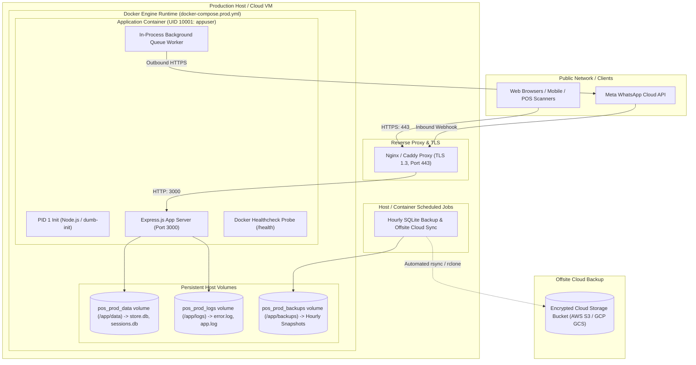

# Deployment & Infrastructure Guide

## 1. Overview & Infrastructure Strategy

The Sri Tirumala Dry Fruits platform is designed for container-native deployment with zero external runtime dependencies. The entire stack—application server, SQLite WAL storage, background queue supervisor, and telemetry—runs inside a single hardened Docker container.

### Process Management Architectural Decision
* **Container-Native Process Supervision**: Docker Engine serves as the PID 1 supervisor (`restart: unless-stopped`).
* **Why NOT PM2 in Docker?** PM2 inside containers creates redundant supervisor conflicts, swallows standard POSIX signals (`SIGTERM`, `SIGINT`), and prevents clean container draining.
* **Bare-Metal Fallback**: `ecosystem.config.cjs` is maintained solely for legacy on-premise hardware where Docker is unavailable.

---

## 2. Deployment Architecture Diagram



---

### 2.1 Reverse Proxy & Edge TLS Normalization
The production host terminates TLS and normalizes public domain variants via Nginx (`nginx/conf.d/sritirumaladryfruits.conf`):
* **Single-Hop 301 Redirect**: Port 80 (HTTP) and Port 443 (HTTPS WWW) immediately redirect to `https://sritirumaladryfruits.com$request_uri` without chained hops.
* **HSTS Preload**: Strict Transport Security (`max-age=63072000; includeSubDomains; preload`) enforced on canonical origin.
* **Proxy Headers**: Injects `Host`, `X-Real-IP`, `X-Forwarded-For`, and `X-Forwarded-Proto https` into the Express container.
* **Application Layer Defense**: If deployed behind Cloudflare or directly, `src/middleware/canonical-redirect.ts` enforces identical single-hop rules, preventing open redirects and rejecting untrusted hostnames.

---

## 3. Container Hardening & Dockerfile Architecture

The production [`Dockerfile`](file:///c:/Projects/sri-tirmula-dryfruits/Dockerfile) uses a hardened multi-stage build:

1. **Stage 1 (`builder`)**: Compiles TypeScript (`npm run build`) and installs native dependencies (`better-sqlite3`, `bcryptjs`).
2. **Stage 2 (`runner`)**: Uses `node:20-alpine`, strips build tools and dev dependencies, drops root privileges, and executes under an unprivileged user (`node:node` / UID 1000).
3. **Filesystem Security**:
   - `cap_drop: [ALL]` drops Linux kernel capabilities.
   - `security_opt: [no-new-privileges:true]` prevents privilege escalation.
   - `tmpfs: [/tmp:rw,noexec,nosuid,size=64m]` provides secure, temporary storage.
4. **Native Healthcheck**:
   ```dockerfile
   HEALTHCHECK --interval=30s --timeout=5s --start-period=15s --retries=3 \
     CMD node -e "fetch('http://localhost:3000/health').then(r=>r.ok?process.exit(0):process.exit(1)).catch(()=>process.exit(1))"
   ```

---

## 4. Environment Configuration Matrix

The application supports strict environment segmentation (`development`, `staging`, `production`):

| Variable | Required | Staging Default | Production Requirement | Description |
| :--- | :---: | :--- | :--- | :--- |
| `NODE_ENV` | Yes | `staging` | `production` | Node execution mode. |
| `PORT` | Yes | `3000` | `3000` | Internal listening port. |
| `SITE_URL` | Yes | `https://staging.sritirumaladryfruits.com` | `https://sritirumaladryfruits.com` | Immutable canonical base domain for SEO canonicals, sitemaps, OpenGraph & JSON-LD schemas. |
| `SESSION_SECRET` | Yes | Custom secret | 64+ char random hex string | Signs customer & staff session cookies. |
| `COOKIE_SECRET` | Yes | Custom secret | 64+ char random hex string | Signs signed cookies. |
| `WHATSAPP_TOKEN` | No | Sandbox token | Meta System User Access Token | Cloud API bearer token for notifications. |
| `WHATSAPP_PHONE_NUMBER_ID` | No | Test Phone ID | Meta Business Phone ID | Unique identifier of sender WhatsApp account. |
| `WHATSAPP_WEBHOOK_VERIFY_TOKEN` | No | Custom token | Cryptographically random string | Validates Meta hub challenge verification. |
| `META_APP_SECRET` | No | Test Secret | Meta App Secret | Validates HMAC SHA-256 webhook signatures. |
| `BACKUP_S3_BUCKET` | No | Empty (Local Standby) | S3 Bucket Name (e.g. `sri-tirumala-backups-prod`) | Destination AWS S3 bucket for offsite backup sync. |
| `RCLONE_REMOTE` | No | Empty | Remote name (e.g. `r2:sri-tirumala`) | Optional Rclone remote for Cloudflare R2 / Backblaze. |
| `BACKUP_OFFSITE_DIR` | No | `/app/backups/offsite` | Mounted S3/Rclone mount | Destination for synchronized backup snapshots. |

---

## 5. Production Backup & Disaster Recovery Operations

The production container includes integrated CLI utilities compiled into `dist/scripts/`:

```bash
# 1. Trigger an on-demand verified atomic SQLite backup
docker compose exec pos-app npm run backup
# Or directly:
# docker compose exec pos-app node dist/scripts/run_backup.js

# 2. Trigger offsite synchronization for the latest backup
docker compose exec pos-app npm run backup:offsite

# 3. Execute disaster recovery restore into target database
docker compose exec pos-app node dist/scripts/restore_backup.js /app/data/backups/backup_<timestamp>.db /app/data/store.db
```

Backups are executed with:
- Mandatory SQLite WAL checkpoint (`wal_checkpoint(TRUNCATE)`) prior to backup
- Native `better-sqlite3` lock-free online backup API
- Deterministic timestamp naming (`backup_YYYY-MM-DD_HH-mm-ss.db`) and SHA-256 integrity verification
- Sandbox restore validation drill proving read/write viability
- Offsite replication verification via `scripts/sync_cloud_backup.sh`
- Automatic 30-day retention with a non-deletable 5-backup safety baseline

---

## 6. Deployment Procedures

### 6.1 Local & Staging Deployment

```bash
# 1. Clone repository
git clone https://github.com/gunasekhar-7/SriTrimulaDryFruits.git
cd SriTrimulaDryFruits

# 2. Configure staging environment
cp .env.staging.example .env

# 3. Launch with Docker Compose
docker compose -f docker-compose.staging.yml up -d --build

# 4. Verify running health status
docker compose -f docker-compose.staging.yml ps
```

### 6.2 Production Deployment

```bash
# 1. Export production release tag
export IMAGE_TAG="v2.4.0"

# 2. Validate secrets presence
node scripts/generate_secrets.js --verify

# 3. Build and launch production stack
docker compose -f docker-compose.prod.yml up -d --build

# 4. Confirm container health status
curl -f http://localhost:3000/health
```

---

## 7. Graceful Shutdown & Zero-Downtime Updates

When a deployment update or container restart is triggered:

1. **Signal Catch**: Docker sends `SIGTERM` to PID 1.
2. **Stop Accepting New Connections**: The HTTP server stops accepting new connections while honoring in-flight requests within a 15-second grace window (`stop_grace_period: 15s`).
3. **Queue Draining**: The background worker pauses job ingestion.
4. **SQLite WAL Checkpoint**: The database driver executes `PRAGMA wal_checkpoint(TRUNCATE)` and closes `store.db` cleanly, guaranteeing zero database file corruption.

---

## 8. Rollback Procedure

If a deployed release experiences runtime regressions:

```bash
# 1. Revert to previous immutable image tag
export IMAGE_TAG="v2.3.0"
docker compose -f docker-compose.prod.yml up -d

# 2. Verify health of reverted container
docker compose -f docker-compose.prod.yml ps
curl -f http://localhost:3000/health
```
