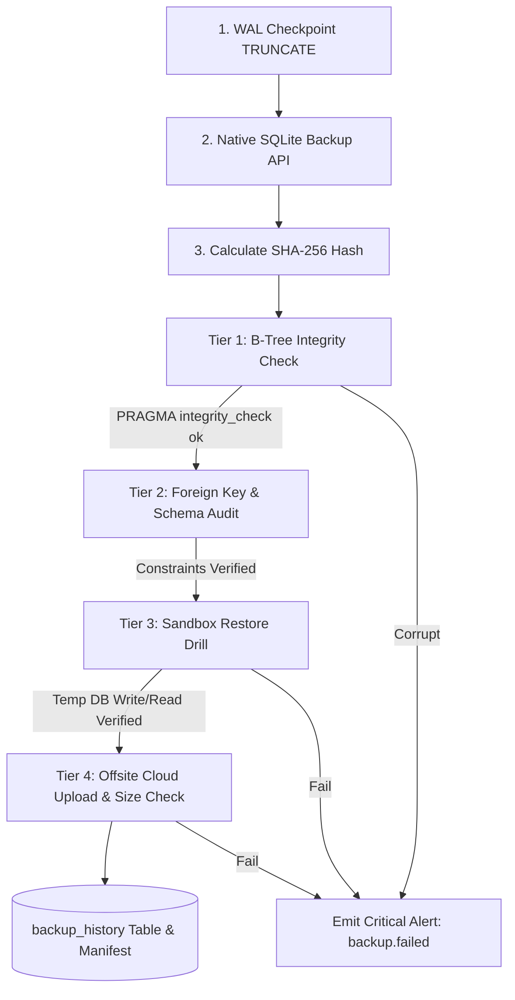

# Disaster Recovery & Business Continuity Plan (BCP)

**System:** Sri Tirumala Dry Fruits — POS & E-Commerce Platform  
**Owner:** Senior Site Reliability Engineering (SRE)  
**Database Architecture:** SQLite (`better-sqlite3`) in Write-Ahead Logging (WAL) Mode  
**Offsite Storage:** AWS S3 / Cloudflare R2 / Encrypted Remote Storage  

---

## 1. Executive Summary & Business Context

Sri Tirumala Dry Fruits operates a high-volume physical retail counter (cash, UPI, card, and thermal barcode billing) combined with an online WhatsApp storefront. 

The integrity of our ledger, inventory counts, and cash drawer shift registers directly impacts daily revenue and customer trust. This document outlines our data durability architecture, defines realistic **RPO** and **RTO** baselines, details specific disaster playbooks, and establishes our automated backup verification protocols.

> ### 🚨 The SRE Golden Rule:
> **An unverified backup file is merely a wish.** We do not claim our backup system is reliable simply because a `.db` file exists on disk. Every backup undergoes automated SHA-256 checksumming, SQLite B-Tree integrity analysis, and an isolated **sandbox restore drill** where actual transactional writes and reads are executed and proven.

---

## 2. Business-Driven RPO & RTO Objectives

### A. Recovery Point Objective (RPO) — Maximum Tolerable Data Loss

| Tier / Scenario | Target RPO | Implementation Mechanism | Business Rationale |
| :--- | :--- | :--- | :--- |
| **Peak Business Hours (9:00 AM – 10:00 PM IST)** | **≤ 1 Hour** | Hourly automated WAL checkpoints and hot backups (`backupService.createBackup`) | Losing more than 1 hour of physical billing during festive or weekend rush hours results in unrecoverable inventory discrepancies and customer billing disputes. |
| **Cash Drawer & Shift Reconciliation** | **≤ 15 Minutes** | Synchronous WAL sync upon shift opening, cash entry, and shift closing | Cashiers reconcile physical drawer cash against recorded transactions; shift closures flush immediately. |
| **Offsite Cloud Disaster Archive** | **≤ 24 Hours** | Nightly consolidated backup at 11:30 PM with offsite cloud replication | Provides catastrophic datacenter loss protection with 30–90 day historical retention. |

### B. Recovery Time Objective (RTO) — Maximum Tolerable Downtime

| Failure Scenario | Target RTO | Strategy | Business Rationale |
| :--- | :--- | :--- | :--- |
| **Local Database Corruption / Lockout** | **≤ 5 Minutes** | Instant local atomic swap from `/app/data/backups/` | Physical customers cannot stand at the billing counter for more than 5 minutes before leaving. |
| **Failed Deployment / Erroneous Migration** | **≤ 5 Minutes** | Docker image tag revert + pre-migration snapshot restore | Fast rollback preserves counter uptime during midday updates. |
| **Accidental Deletion / Bad Admin Edit** | **≤ 15 Minutes** | Point-in-time extraction from pre-restore/hourly backup | Fast data recovery for accidental drops without impacting unaffected tables. |
| **Total Server / Hardware Host Failure** | **≤ 30 Minutes** | Standby VM container spin-up, S3 cloud pull, DNS repointing | Host rebuild and DNS propagation baseline for cloud failure recovery. |

---

## 3. The 4-Tier Automated Verification Architecture



1. **Tier 1 — B-Tree Integrity Verification:**  
   The candidate file is opened in `readonly` mode. `PRAGMA integrity_check;` is executed. If anything other than `ok` is returned, the backup is quarantined.
2. **Tier 2 — Foreign Key & Critical Table Count:**  
   `PRAGMA foreign_key_check;` ensures relational integrity. Row counts across `users`, `products`, and `bills` must match expected baselines.
3. **Tier 3 — Sandbox Restore Drill (Proving Restorability):**  
   The candidate file is copied into an isolated temporary database (`sandbox_restore_<timestamp>.db`). An active read-write connection executes:
   ```sql
   CREATE TEMPORARY TABLE _restore_drill (id INTEGER PRIMARY KEY, drill_at TEXT);
   INSERT INTO _restore_drill VALUES (1, CURRENT_TIMESTAMP);
   SELECT * FROM _restore_drill;
   DROP TABLE _restore_drill;
   ```
   Upon successful write/read validation, the sandbox is unlinked. The backup is marked `restore_verified = 1`.
4. **Tier 4 — Upload Verification:**  
   `scripts/sync_cloud_backup.sh` replicates the archive to AWS S3 / Cloudflare R2 and verifies that the remote object exists and size matches the local file.

---

## 4. Disaster Recovery Playbooks

### Playbook 1: Local Database Corruption (`SQLITE_CORRUPT`)
* **Symptom:** Logs show `SqliteError: database disk image is malformed` or queries fail with `SQLITE_CORRUPT`.
* **Empirical Execution Time:** ~2–3 minutes (Measured CLI restore: ~20ms, container stop/start: ~15s).

#### Method A: Using the Automated Production CLI Restore Command (Recommended)
The production image includes an atomic restore utility (`dist/scripts/restore_backup.js`) that automatically captures a pre-restore forensic snapshot, purges stale WAL/SHM journals, verifies B-tree integrity, and validates tables:

```bash
# 1. Stop writes by isolating or stopping the container
docker compose stop pos-app

# 2. Identify the latest verified backup from manifest or filesystem
LATEST_BACKUP=$(ls -t data/backups/backup_*.db | head -n 1)
echo "Identified candidate: $LATEST_BACKUP"

# 3. Execute atomic restore CLI
node dist/scripts/restore_backup.js "$LATEST_BACKUP" data/store.db
# Or inside a one-off task container:
# docker compose run --rm pos-app node dist/scripts/restore_backup.js "$LATEST_BACKUP"

# 4. Restart container
docker compose start pos-app

# 5. Verify health & endpoints
curl -f http://localhost:3000/health
```

#### Method B: Manual Host Volume Recovery Runbook
If Node.js is unavailable on the host:

```bash
# 1. Stop the application container to freeze all I/O
docker compose stop pos-app

# 2. Inspect named volume path
DATA_DIR=$(docker volume inspect sri_tirumala_pos_data --format '{{ .Mountpoint }}')

# 3. Take forensic snapshot of corrupted file for post-mortem analysis
TIMESTAMP=$(date +%Y%m%d_%H%M%S)
cp "$DATA_DIR/store.db" "$DATA_DIR/store_corrupted_${TIMESTAMP}.db"

# 4. Remove damaged WAL and SHM journal files
rm -f "$DATA_DIR/store.db-wal" "$DATA_DIR/store.db-shm"

# 5. Locate latest verified backup (sorted by filename timestamp)
LATEST_BACKUP=$(ls -t "$DATA_DIR/backups"/backup_*.db | head -n 1)
echo "Restoring from verified candidate: $LATEST_BACKUP"

# 6. Copy verified backup over live database
cp "$LATEST_BACKUP" "$DATA_DIR/store.db"
chown 1000:1000 "$DATA_DIR/store.db"

# 7. Run SQLite PRAGMA integrity check on restored file
sqlite3 "$DATA_DIR/store.db" "PRAGMA integrity_check;"
# MUST RETURN: "ok"

# 8. Validate critical business invariants before resuming traffic
sqlite3 "$DATA_DIR/store.db" "
  SELECT 'Products Count:', COUNT(*) FROM products;
  SELECT 'Users Count:', COUNT(*) FROM users;
  SELECT 'Bills Count:', COUNT(*) FROM bills;
  SELECT 'Negative Stock Violations:', COUNT(*) FROM product_variants WHERE (total_qty - sold_qty) < 0;
"

# 9. Handle persistent sessions hygiene:
# NEVER restore an obsolete sessions.db. Stale sessions cause authentication desynchronization.
# If session corruption is suspected, cleanly purge sessions.db to force clean re-login:
# rm -f "$DATA_DIR/sessions.db" "$DATA_DIR/sessions.db-wal" "$DATA_DIR/sessions.db-shm"

# 10. Start container
docker compose start pos-app

# 11. Verify health probe
curl -f http://localhost:3000/health
```

---

### Playbook 2: Total Server / Hardware Host Failure
* **Symptom:** Host VM is unresponsive, hardware disk failed, or cloud instance terminated.
* **Execution Time:** ~20 minutes.

```bash
# 1. Provision fresh standby cloud VM (Ubuntu 22.04 LTS / 24.04 LTS)
# 2. Install Docker & Docker Compose
curl -fsSL https://get.docker.com | sh
usermod -aG docker ubuntu

# 3. Clone repository and checkout release tag
git clone https://github.com/gunasekhar-7/SriTrimulaDryFruits.git /opt/sri-tirumala
cd /opt/sri-tirumala
git checkout v1.2.0

# 4. Pull latest offsite backup archive from AWS S3
mkdir -p ./data/backups
aws s3 sync s3://sri-tirumala-backups-prod/backups/ ./data/backups/ --exclude "*" --include "backup_*.db"

# 5. Select latest verified backup and initialize live database
LATEST_BACKUP=$(ls -t ./data/backups/backup_*.db | head -n 1)
cp "$LATEST_BACKUP" ./data/store.db

# 6. Verify SQLite integrity
sqlite3 ./data/store.db "PRAGMA integrity_check;"

# 7. Launch application container with production compose
docker compose -f docker-compose.yml -f docker-compose.prod.yml up -d

# 8. Update DNS / Cloudflare A-Record to point to new host IP
# 9. Verify production endpoints
curl -f https://pos.sritirumaladryfruits.com/health
```

---

### Playbook 3: Accidental Deletion / Table Corruption
* **Symptom:** A cashier or admin accidentally truncates orders or deletes critical product variants.
* **Execution Time:** ~10 minutes.

```bash
# 1. Do NOT overwrite the entire live database if only specific rows are needed!
# 2. Copy the latest hourly backup to a forensic analysis directory
mkdir -p /tmp/dr_extract
LATEST_BACKUP=$(ls -t /srv/sri-tirumala/data/backups/backup_*.db | head -n 1)
cp "$LATEST_BACKUP" /tmp/dr_extract/snapshot.db

# 3. Query the missing records from the snapshot database
sqlite3 /tmp/dr_extract/snapshot.db "SELECT * FROM products WHERE id IN (10, 11, 12);"

# 4. Export deleted records to SQL insert statements
sqlite3 /tmp/dr_extract/snapshot.db ".dump products" > /tmp/dr_extract/products_dump.sql

# 5. Cleanly restore missing records into the live database
sqlite3 /srv/sri-tirumala/data/store.db < /tmp/dr_extract/products_dump.sql

# 6. Clean up temporary extraction directory
rm -rf /tmp/dr_extract
```

---

### Playbook 4: Failed Deployment / Bad Schema Migration
* **Symptom:** A newly deployed release fails to start due to an erroneous migration or application crash.
* **Execution Time:** ~3 minutes.

```bash
# 1. Rollback container image to previous immutable tag
export PREVIOUS_STABLE_TAG="v1.1.9"
docker compose -f docker-compose.yml -f docker-compose.prod.yml up -d

# 2. If the migration modified the schema, restore pre-migration snapshot
DATA_DIR=$(docker volume inspect sri_tirumala_pos_data --format '{{ .Mountpoint }}')
PRE_MIG_BACKUP=$(ls -t "$DATA_DIR/backups"/pre_migration_*.db 2>/dev/null | head -n 1)

if [ -n "$PRE_MIG_BACKUP" ]; then
  docker compose stop pos-app
  cp "$PRE_MIG_BACKUP" "$DATA_DIR/store.db"
  chown 1000:1000 "$DATA_DIR/store.db"
  docker compose start pos-app
fi

# 3. Verify health
curl -f http://localhost:3000/health
```

---

## 5. Retention Policy & Disk Management

To prevent storage exhaustion while maintaining regulatory compliance:

* **Local Storage Retention:**
  * Retains daily and hourly backups for **30 days**.
  * **Safe Minimum Baseline:** The cleaner will **never delete the last 5 backups**, even if they exceed 30 days.
* **Cloud Storage Retention (AWS S3 / Glacier):**
  * Backups older than **30 days** automatically transition to **S3 Standard-IA**.
  * Backups older than **90 days** transition to **S3 Glacier Flexible Retrieval**.
  * Backups older than **365 days** are purged.

---

## 6. Disaster Recovery Testing & Fire Drills

Reliability is proven through continuous and scheduled drills:

1. **Continuous Automated Verification (Every Backup):**
   * Every backup executed via cron automatically runs Tier 1, 2, and 3 verification before being logged as `PASSED`.
2. **Monthly Simulated Restore Fire Drill:**
   * On the 1st Sunday of each month at 11:00 PM:
   * SRE initiates a full disaster recovery drill in a staging container:
     1. Downloads latest S3 offsite backup.
     2. Restores into a blank test environment.
     3. Runs the full integration test suite (`npm run test:integration`).
     4. Records confirmation report in SRE operational records.
