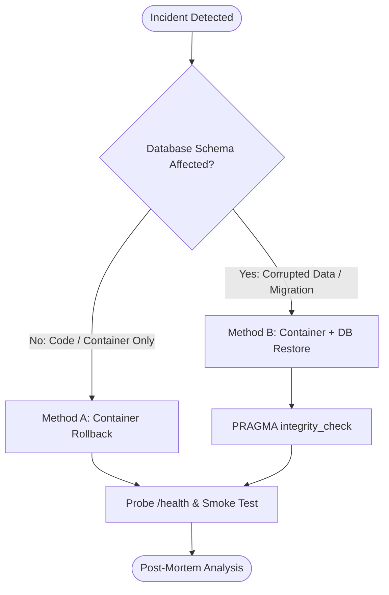

# Production Rollback & Disaster Recovery Runbook

This runbook defines the standard operating procedures (SOP) for executing emergency rollbacks of the Sri Tirumala Dry Fruits POS and E-commerce system.

---

## 1. Rollback Trigger Criteria

An immediate rollback is mandatory when any of the following conditions occur post-deployment:
1. **Health / Readiness Failure:** The `/health` or `/ready` endpoint returns HTTP non-200 or fails to respond within 5 seconds for > 3 consecutive checks.
2. **Elevated Error Rates:** 5xx HTTP response rate exceeds **1.0%** over a 5-minute rolling window.
3. **Critical Path Failure:** Any disruption to core transaction flows:
   - POS terminal fails to scan barcodes or finalize bills.
   - Online checkout throws unhandled exceptions during stock reservation.
   - WhatsApp order confirmation notifications persistently fail.
4. **Data Corruption / Migration Anomaly:** SQLite throws `SQLITE_CORRUPT`, locking deadlocks (`SQLITE_BUSY`), or schema validation discrepancies.
5. **Security Alert:** Identification of a secret leak, unauthorized privilege escalation, or critical vulnerability.

---

## 2. Rollback Mechanisms



---

## 3. Method A: Application Container Rollback

### Option 1: 1-Click Rollback via GitHub Actions (Recommended)
1. Navigate to the GitHub repository **Actions** tab.
2. Select **Production CI/CD Pipeline** in the left sidebar.
3. Click **Run workflow**:
   - **Target Deployment Environment:** `production`
   - **Set to true to execute an emergency rollback:** Checked (`true`)
   - **rollback_image_tag:** Enter the previous stable commit SHA or tag (e.g., `sha-a1b2c3d` or `v1.2.3`).
4. Click **Run workflow**.
5. The pipeline automatically terminates the degraded container, pulls the specified stable image tag, starts the container with existing persistent volumes, and validates the `/health` endpoint.

---

### Option 2: Emergency Manual CLI Rollback (SSH / Host Terminal)
If GitHub Actions is unreachable or network connectivity to GitHub is impaired:

```bash
# 1. SSH into the production server
ssh -i ~/.ssh/prod_key devops@pos.sritirumaladryfruits.com

# 2. View running containers and identify image IDs
docker ps --filter "name=sri-tirumala-pos"

# 3. Identify previous stable image tag
docker images sri-tirumala-pos

# 4. Gracefully stop degraded container (allows active DB transactions 15s to flush)
docker stop -t 15 sri-tirumala-pos

# 5. Relaunch previous stable image with persistent volumes intact
docker run -d \
  --name sri-tirumala-pos-stable \
  --restart always \
  -p 3000:3000 \
  --env-file /etc/sri-tirumala/production.env \
  -v /srv/sri-tirumala/data:/app/data \
  -v /srv/sri-tirumala/logs:/app/logs \
  sri-tirumala-pos:<PREVIOUS_STABLE_TAG>

# 6. Verify healthcheck status
docker inspect --format='{{json .State.Health.Status}}' sri-tirumala-pos-stable

# 7. Clean up degraded container once stable is verified
docker rm sri-tirumala-pos
docker rename sri-tirumala-pos-stable sri-tirumala-pos
```

---

## 4. Method B: Database Rollback & Point-in-Time Recovery

If the failed release executed an erroneous schema migration or corrupted SQLite records:

### Step 1: Freeze Ingress & Stop Application
```bash
# Prevent new orders/writes during recovery
docker stop -t 10 sri-tirumala-pos
```

### Step 2: Take Forensic Snapshot of Current Corrupted Database
```bash
# NEVER overwrite a database without taking an immediate pre-restore snapshot
TIMESTAMP=$(date +%Y%m%d_%H%M%S)
cp /srv/sri-tirumala/data/store.db "/srv/sri-tirumala/data/store_corrupted_${TIMESTAMP}.db"
[ -f /srv/sri-tirumala/data/store.db-wal ] && cp /srv/sri-tirumala/data/store.db-wal "/srv/sri-tirumala/data/store_corrupted_${TIMESTAMP}.db-wal"
```

### Step 3: Locate Latest Verified Pre-Deployment Backup
```bash
# Check local backup storage (created automatically by cron/pre-deployment hook)
ls -lht /srv/sri-tirumala/data/backups/

# Or retrieve latest verified offsite cloud snapshot from S3 / R2:
# aws s3 cp s3://sri-tirumala-backups-prod/latest_backup.db /tmp/restore_target.db
```

### Step 4: Perform Atomic Database Restore & Validation
```bash
RESTORE_FILE="/srv/sri-tirumala/data/backups/backup_YYYYMMDD_HHMMSS.db"

# 1. Clear active WAL and SHM journal files
rm -f /srv/sri-tirumala/data/store.db-wal /srv/sri-tirumala/data/store.db-shm

# 2. Atomically copy verified backup file
cp "$RESTORE_FILE" /srv/sri-tirumala/data/store.db

# 3. Ensure permissions are set to node:node (UID 1000)
chown 1000:1000 /srv/sri-tirumala/data/store.db

# 4. Execute SQLite PRAGMA integrity verification
sqlite3 /srv/sri-tirumala/data/store.db "PRAGMA integrity_check;"
# Expected output: ok
sqlite3 /srv/sri-tirumala/data/store.db "PRAGMA foreign_key_check;"
# Expected output: (empty, meaning zero FK violations)
```

### Step 5: Start Previous Stable Application
```bash
docker start sri-tirumala-pos
```

---

## 5. Post-Rollback Verification Checklist

Immediately upon rolling back, execute this 6-point verification:

- [ ] **Liveness & Health Probe:**
  ```bash
  curl -i https://pos.sritirumaladryfruits.com/health
  # Must return HTTP 200 with status: "healthy"
  ```
- [ ] **Database Connectivity:**
  Verify logs show `Database initialized successfully in WAL mode` with zero lock warnings:
  ```bash
  docker logs --tail 100 sri-tirumala-pos
  ```
- [ ] **Staff POS Shift & Sell Test:**
  Log in as cashier (`staff1`), verify active shift opens, and scan test barcode (`E2E_BC_...`).
- [ ] **Customer Storefront Browsing:**
  Load `https://pos.sritirumaladryfruits.com/` and confirm product catalog and cart render.
- [ ] **Background Queue State:**
  Confirm background queue worker resumes claims without unhandled exception loops.
- [ ] **Metrics & Prometheus Telemetry:**
  Confirm Prometheus `/metrics` reports `http_requests_total` with 2xx/3xx codes and 5xx rate = 0.

---

## 6. Incident Communication & Post-Mortem

Within 24 hours of any production rollback, submit a Post-Incident Review (PIR) covering:
1. **Summary:** Exact timeline from deployment to incident detection and rollback completion.
2. **Impact:** Number of impacted store transactions or affected online carts.
3. **Root Cause:** Analysis of why the failure occurred (code regression, migration issue, third-party API timeout).
4. **Test Gap Analysis:** Identify why the test suite / staging verification did not catch the issue prior to production.
5. **Remediation Action Items:** Concrete PRs or pipeline enhancements to prevent recurrence.
