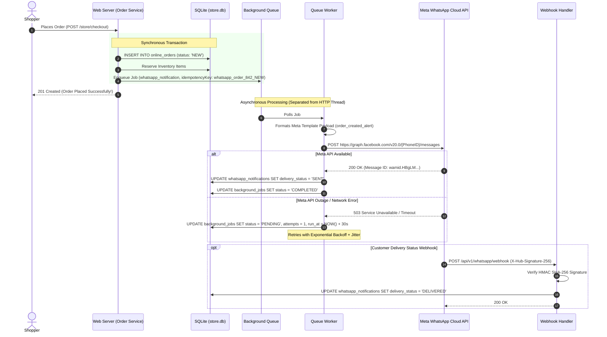

# WhatsApp Cloud API Integration & Notification Architecture

## 1. Architectural Overview & Reliability Guarantee

Sri Tirumala Dry Fruits automates customer communication via the **Meta WhatsApp Cloud API**.

### Critical Reliability Invariant: Non-Blocking Order Flow
A fundamental design requirement of the notification subsystem is **fault isolation**:
* **Order Creation Must Never Block**: If Meta's servers are experiencing an outage, network latency, or credential expiration, **the customer's order placement or staff POS transaction must still succeed immediately**.
* **Durable Independent Execution**: Notification delivery is delegated to an in-process SQLite background job queue. The worker executes independently, retrying with exponential backoff and preserving error states without affecting the main transaction.

---

## 2. WhatsApp Notification Sequence Diagram

The following sequence diagram details the end-to-end lifecycle of an order notification, demonstrating asynchronous decoupling, retry behavior, and webhook acknowledgment:



---

## 3. Message Template Catalog

The system maps order state machine transitions to approved Meta template names in [`src/services/whatsapp.service.ts`](file:///c:/Projects/sri-tirmula-dryfruits/src/services/whatsapp.service.ts):

| Order Status | Meta Template Name | Parameters Injected | Message Intent |
| :--- | :--- | :--- | :--- |
| `NEW` | `order_created_alert` | `customerName`, `orderNumber` | Confirms order receipt and review in progress. |
| `CONFIRMED` | `order_confirmed_alert` | `customerName`, `orderNumber` | Alerts customer that order is accepted and being processed. |
| `PACKING` | `order_packing_alert` | `customerName`, `orderNumber` | Informs customer that items are being packed. |
| `READY` | `order_ready_pickup_alert` | `customerName`, `orderNumber` | Informs customer that order is ready for in-store collection. |
| `DISPATCHED` | `order_dispatched_alert` | `customerName`, `orderNumber` | Notifies customer that delivery driver has departed. |
| `COMPLETED` | `order_delivered_alert` | `customerName`, `orderNumber` | Confirms successful handover / payment receipt. |
| `CANCELLED` | `order_cancelled_alert` | `customerName`, `orderNumber` | Alerts customer of order cancellation and refund details. |

---

## 4. Idempotency & Duplicate Prevention

To prevent customers from receiving duplicate WhatsApp alerts if webhooks or jobs are re-delivered:

1. **Idempotency Key Formulation**:
   $$\text{idempotencyKey} = \text{whatsapp\_order\_}\{\text{orderId}\}\_\{\text{status}\}$$
   * Example: `whatsapp_order_842_CONFIRMED`
2. **Database Constraint**:
   The `whatsapp_notifications` table enforces a composite unique key:
   ```sql
   UNIQUE(order_id, status_event)
   ```
   If a duplicate notification job is evaluated, the service detects the existing record and safely skips dispatch.

---

## 5. Webhook Security & Signature Verification

Meta sends delivery updates and customer inbound messages to `POST /api/v1/whatsapp/webhook`.

### Signature Verification Algorithm
Every incoming POST request contains the header `X-Hub-Signature-256`. The handler validates the payload:

```typescript
const signature = req.headers['x-hub-signature-256'] as string;
const expectedSignature = 'sha256=' + crypto
  .createHmac('sha256', process.env.META_APP_SECRET!)
  .update((req as any).rawBody)
  .digest('hex');

if (!crypto.timingSafeEqual(Buffer.from(signature), Buffer.from(expectedSignature))) {
  return res.status(401).send('Invalid signature');
}
```

* **Timing Attack Prevention**: `crypto.timingSafeEqual` prevents side-channel timing analysis attacks.

---

## 6. Dead-Letter State & Manual Retry Controls

If a WhatsApp notification fails continuously across all 5 retry attempts:

1. The job transitions to `status = 'FAILED'`.
2. The full error message and stack trace are preserved in `last_error`.
3. Administrators can inspect failed notifications via the Admin Portal (`/jobs`) and trigger a manual retry with a single click once network connectivity is restored.
